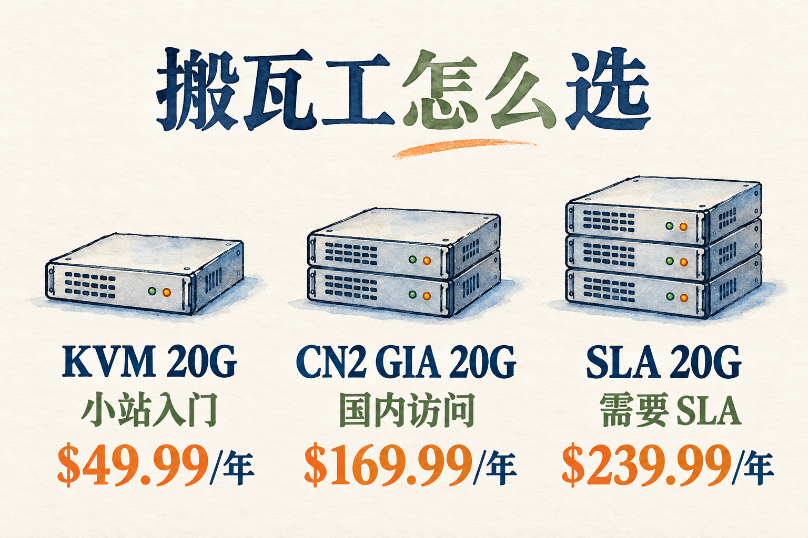

# 搬瓦工 VPS 怎么选？套餐价格、CN2 GIA 和购买教程

搬瓦工（BandwagonHost）卖的是需要自己管理的 VPS。选购时最容易纠结的，是普通 KVM 和 CN2 GIA 差在哪、机房怎么选，以及一年到底要花多少钱。

我把套餐价格、机房选择、付款周期和购买步骤都放在这一页。想快点选定，先看三款建议；想多比一比，接着往下看就行。

## 它好在哪里

**线路。** 国内访问国外服务器，除了配置，还得看数据走哪条路。搬瓦工有普通线路，也有 CN2 GIA 等面向中国网络的线路选择，预算可以按用途来分。

**机房。** 洛杉矶、香港、东京、大阪等地都有选择。普通 KVM 和常规 CN2 GIA 套餐支持在各自可用的机房里免费迁移，买之前能选，买之后也能调整。

**面板。** KiwiVM 后台能重装系统、看流量、迁机房、打快照，常用的操作自己在面板里就能完成。

**付款。** 支持支付宝、PayPal、信用卡，不用专门去办双币卡。

## KVM、CN2 GIA 和 SLA 怎么选

名字一大堆，其实就三类：普通线路的 KVM、回国线路的 CN2 GIA、带保障的 SLA。

普通线路便宜，放个博客、跑个脚本、当跳板都够用，一年五十美元起步。

CN2 GIA 是中国电信的一类优质网络接入。搬瓦工的 CN2 GIA 20G 和普通 KVM 20G 入门配置接近，年付分别是 $169.99 和 $49.99，主要差在线路。网站给国内的人看，或者经常从国内连上去写代码，可以优先比较这一档。

还有个好处：**同一个价格能选 15 个机房**。洛杉矶三个、圣何塞、弗里蒙特、纽约两个、温哥华两个、阿姆斯特丹三个，再加迪拜、东京、大阪。正常使用时，可以在套餐支持的机房之间免费迁移，官方说明迁移会保留数据。买完发现位置不合用，还有调整的余地。

SLA 多了 99.99% 的可用性承诺，还有每两周免费换一次 IP。适合正经跑业务的人，自己玩没必要。这档目前只有洛杉矶 USCA_5 一个机房。

香港、东京、大阪也有独立的 CN2 GIA 套餐，起步是 2G 内存，适合明确需要这些位置的人。它们价格更高，当前各只对应一个机房。

## 不想挨个比，先看这三款

- **放个小站、学 Linux：KVM 20G。** 1 GB 内存、20 GB 硬盘，$49.99/年，适合先买一台入门。👉 [从这款看起](https://bandwagonhost.com/aff.php?aff=82279&pid=44)
- **主要给国内的人用：CN2 GIA 20G。** 同样是 1 GB 内存、20 GB 硬盘，$169.99/年，多花的钱用在线路上。👉 [看看这款 CN2 GIA](https://bandwagonhost.com/aff.php?aff=82279&pid=87)
- **跑业务，需要可用性承诺：SLA 20G。** $239.99/年，带 99.99% SLA 和每两周免费换一次 IP 的服务，机房是洛杉矶 USCA_5。👉 [看看 SLA 这一档](https://bandwagonhost.com/aff.php?aff=82279&pid=164)

## 搬瓦工套餐多少钱？常见配置价格表

| 套餐名称 | 内存 | 硬盘 | 月流量 | 带宽 | 价格 | 购买链接 |
| --- | --- | --- | --- | --- | --- | --- |
| KVM 20G | 1 GB | 20 GB SSD | 1 TB | 1 Gbps（125 MB/s） | $49.99/年 | [立即购买](https://bandwagonhost.com/aff.php?aff=82279&pid=44) |
| KVM 40G | 2 GB | 40 GB SSD | 2 TB | 1 Gbps（125 MB/s） | $52.99/半年，$99.99/年 | [立即购买](https://bandwagonhost.com/aff.php?aff=82279&pid=45) |
| KVM 80G | 4 GB | 80 GB SSD | 3 TB | 1 Gbps（125 MB/s） | $19.99/月 | [立即购买](https://bandwagonhost.com/aff.php?aff=82279&pid=46) |
| KVM 160G | 8 GB | 160 GB SSD | 4 TB | 1 Gbps（125 MB/s） | $39.99/月 | [立即购买](https://bandwagonhost.com/aff.php?aff=82279&pid=47) |
| KVM 320G | 16 GB | 320 GB SSD | 5 TB | 1 Gbps（125 MB/s） | $79.99/月 | [立即购买](https://bandwagonhost.com/aff.php?aff=82279&pid=48) |
| CN2 GIA 20G | 1 GB | 20 GB SSD | 1 TB | 2.5 Gbps（312.5 MB/s） | $49.99/季，$169.99/年 | [立即购买](https://bandwagonhost.com/aff.php?aff=82279&pid=87) |
| CN2 GIA 40G | 2 GB | 40 GB SSD | 2 TB | 2.5 Gbps（312.5 MB/s） | $89.99/季，$299.99/年 | [立即购买](https://bandwagonhost.com/aff.php?aff=82279&pid=88) |
| CN2 GIA 80G | 4 GB | 80 GB SSD | 3 TB | 2.5 Gbps（312.5 MB/s） | $56.99/月 | [立即购买](https://bandwagonhost.com/aff.php?aff=82279&pid=89) |
| 大阪 CN2 GIA 40G | 2 GB | 40 GB SSD | 500 GB | 1.5 Gbps（187.5 MB/s） | $49.99/月 | [立即购买](https://bandwagonhost.com/aff.php?aff=82279&pid=134) |
| 香港 CN2 GIA 40G | 2 GB | 40 GB SSD | 500 GB | 1 Gbps（125 MB/s） | $89.99/月，$899.99/年 | [立即购买](https://bandwagonhost.com/aff.php?aff=82279&pid=95) |
| 香港 CN2 GIA 80G | 4 GB | 80 GB SSD | 1 TB | 1 Gbps（125 MB/s） | $155.99/月，$1559.99/年 | [立即购买](https://bandwagonhost.com/aff.php?aff=82279&pid=96) |
| 东京 CN2 GIA 40G | 2 GB | 40 GB SSD | 500 GB | 1.2 Gbps（150 MB/s） | $89.99/月，$899.99/年 | [立即购买](https://bandwagonhost.com/aff.php?aff=82279&pid=108) |
| SLA 20G（DC5） | 1 GB | 20 GB NVMe | 1 TB | 2.5 Gbps（312.5 MB/s） | $65.89/季，$239.99/年 | [立即购买](https://bandwagonhost.com/aff.php?aff=82279&pid=164) |

带宽括号里是换算后的理论速度，实际下载速度还要看线路和使用情况。

价格是官网现在的标价，活动的时候会低一点，以结账页为准。限量版套餐库存不稳定，没列进来，需要的话直接去官网看。

## 搬瓦工可以月付吗？季付和年付怎么选

可以，但不是每款都能月付。**KVM 20G 只有年付，一次付 $49.99；CN2 GIA 20G 从季付起，一次付 $49.99。** 数字一样，买到的时间不一样。

普通 KVM 40G 支持半年付和年付；KVM 80G 才有 $19.99/月的选项。需要月付时，要一起比较配置和总价，不能只看付款周期。

CN2 GIA 20G 的年付是 $169.99。连续付四个季度要 $199.96，比年付多 $29.97。我会这样选：确定用满一年，就年付；还在确认需求，就先季付。

看到「月均多少钱」，记得再看一次本次应付总价。年付折算后的月均成本，不等于可以只买一个月。续费金额也在下单时一起确认。

## 搬瓦工机房怎么选？DC6、DC9、香港和日本

先看用途，再看城市。主要给国内用户访问、预算又不想太高，我会先比较洛杉矶 DC6 和 DC9；明确需要香港或日本节点，再看对应套餐。

**DC6 是 USCA_6，DC9 是 USCA_9。** 常规 CN2 GIA 套餐可以选这两个机房，官网都列有电信 CN2 GIA、移动 CMIN2 和联通 Premium 等线路。实际效果用自己的宽带测，白天和晚上各试一次。

前面说的「同价可选 15 个机房」，不代表这 15 个机房的线路完全相同。套餐里可选的东京 JPTY_1、大阪 JPOS_1，也和独立出售的东京 JPTY_8、大阪 JPOS_6 不是同一个选项。

独立的香港、东京 CN2 GIA 40G 都是 $899.99/年起，大阪 CN2 GIA 40G 是 $499.99/年起。这几款在当前目录里各只有一个机房。确实需要那个位置，再按相应的配置和价格选。

迁机房只换位置，不换配置。普通 KVM 和常规 CN2 GIA 可以在各自套餐支持的范围内免费迁移；内存或硬盘不够，要另外考虑升级。IP 在黑名单里时，还有连续七天不在黑名单才可迁移的限制。

## 搬瓦工 SLA 套餐多了什么，值不值得买

SLA 20G 在洛杉矶 USCA_5，也就是 DC5。年付 $239.99，比常规 CN2 GIA 20G 多 $70。除了配置和线路，主要比较的是 **99.99% SLA，以及每两周免费换一次 IP 的服务**。

99.99% 是按月计算、有适用范围的可用性承诺。符合条件的故障可以申请增加服务时间。它和自己系统配置、第三方网络或 IP 封锁等问题的处理范围不同，选购时要把对应条款一起看。

免费换 IP 是一项可用的服务，不是系统每两周自动更换。换完之后，域名解析、SSH 连接地址等用到旧 IP 的地方，也要一起改。

我会按服务要求来选：想在多个机房间调整位置，看常规 CN2 GIA；需要 SLA 条款、也接受 USCA_5 这个位置，再看 SLA 20G。

## 搬瓦工怎么买？注册、选套餐和支付宝付款

选好用途后，按这个顺序走：

1. **打开对应套餐。** 核对名字、内存、硬盘和月流量，避免把普通 KVM 与 CN2 GIA 看混。
2. **选机房和付款周期。** 看清机房编号，以及这次付的是一个月、一个季度还是一年。
3. **注册或登录账号。** 按官网页面填写资料，邮箱用自己常用的，后面收开通信息和账单都用得上。
4. **核对总价，再付款。** 支持支付宝、PayPal、信用卡；具体可选方式和金额看结账页。使用优惠码时，确认价格已经实际更新。
5. **开通后进 KiwiVM。** 从服务列表进入面板，安装需要的系统，再按服务信息连接 SSH。面板能管理机器，网站环境和数据备份还需要自己配置。

我会在付款前最后看一眼四件事：套餐名、机房、周期、总价。把这四项对上，比下单后再改省事。

## 搬瓦工 SSH 连不上，先查什么

先排除账单、机器状态、端口和本地网络问题，再判断是不是 IP 被封。面板显示 Running，只说明机器开着。

1. **看账单。** 确认服务没有因到期或欠费暂停。
2. **看机器状态。** 进入 KiwiVM，确认 VPS 已启动。
3. **核对端口。** 改过 SSH 端口的，连接工具里也要同步修改。
4. **换网络试。** 用手机热点连接同一个 IP、同一个端口，比较结果。
5. **进控制台。** 用 KiwiVM 的交互控制台查看 SSH 服务和防火墙设置。

Ping 不通，不等于整个 IP 被封。还要比较国内外节点和实际端口的连接情况。确认需要换 IP 后，再看后台的付费更换选项；SLA 套餐则有上面提到的免费换 IP 服务。

## 买之前常问的几个问题

**CN2 GIA 一定比普通线路快吗？** 它提供更好的线路选择，但实际表现和机房、运营商、时段有关。买之前用自己的网络测试，比只看套餐名称更有参考价值。

**能退款吗？** 新订单在 30 天内、满足账户状态、流量使用和 IP 状态等条款条件时，可以申请。续费不按新订单算，购买前先确认用途和对应条件。

**能用来建站吗？** 能。小站可以从入门配置看起，选机房时考虑访客在哪里。系统更新、网站环境和备份由自己管理，KiwiVM 负责提供重装、快照等操作入口。

## 现在去买

想好了就去看看。

👉 [去搬瓦工官网挑一台](https://bandwagonhost.com/aff.php?aff=82279)

想按预算挑，就回到上面的价格表；已经选好用途，就打开对应套餐，确认库存和结账总价。

## 选机器

- [搬瓦工套餐怎么选：KVM、CN2 GIA 和 SLA](articles/02-搬瓦工套餐评估.md)
- [便宜 VPS 怎么挑，搬瓦工入门款适合谁](articles/03-便宜VPS推荐榜单.md)
- [搬瓦工 CN2 GIA 是什么，比普通线路贵在哪](articles/04-CN2GIA线路VPS推荐.md)
- [搬瓦工和其他 VPS 怎么选](articles/05-搬瓦工对比其他VPS.md)
- [洛杉矶、香港、东京和大阪机房怎么选](articles/09-搬瓦工机房怎么选.md)
- [SLA 套餐多了什么，DC5 适合谁](articles/11-搬瓦工SLA套餐.md)

## 买和用

- [搬瓦工怎么买更划算](articles/06-搬瓦工优惠与省钱.md)
- [搬瓦工购买教程：注册、选套餐和支付宝付款](articles/07-搬瓦工注册购买教程.md)
- [搬瓦工可以月付吗，季付和年付怎么选](articles/10-搬瓦工月付季付年付.md)
- [连不上了先查这里](profile/README.md)
- [常见问题](articles/08-搬瓦工常见问题FAQ.md)

---

这里是我个人整理的内容，和搬瓦工官方没关系。价格和条款会变，下单前自己再核对一遍。
