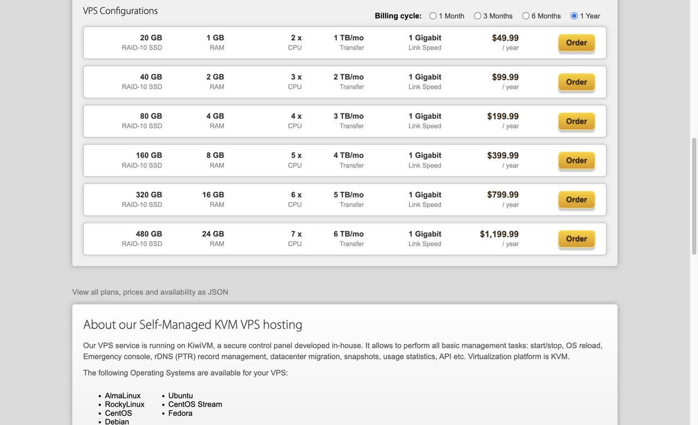

# 搬瓦工哪款值得买

搬瓦工的套餐名字很长，看久了容易晕。其实只有三档，搞清楚区别，五分钟就能定。

## 三档的区别

Basic 是普通线路，洛杉矶机房，1G 内存、20G 硬盘、每月 1T 流量，一年 49.99 美元。

CN2 GIA 的配置和它一模一样，一年 169.99 美元。贵的一百二十美元，买的是回国线路。

SLA 一年 239.99 美元，配置也差不多，多了 99.99% 的可用性承诺，还有每两周免费换一次 IP。

配置没差多少，价格差了三倍，差别全在线路和服务条款上。

## 线路值不值这个钱

要看你给谁用。

网站主要给国内的人看，CN2 GIA 值。晚高峰的时候，普通线路可能卡到打不开，GIA 还能正常刷。这一百二十美元买的就是这段时间的体验。

只是学 Linux、跑个定时脚本、放个给海外用户看的站，Basic 就够，不必为用不上的线路多花钱。

SLA 那档，除非你在上面跑正经业务、需要那份可用性承诺，否则不用考虑。

## 内存和硬盘够不够

三档都是 1G 内存、20G 硬盘，放一个博客、几个小工具，绰绰有余。

要装数据库、存图片、留备份，就得算一算。20G 听着不少，系统占掉几个 G，剩下的装个 WordPress 再加点图，也就差不多了。真不够，还有 40G 的版本，一年 99.99 美元。

## 我的建议

拿不准就先买最便宜的 KVM 20G。一年三百多块，用着不合适，配置可以补差价升级，机房可以免费迁。

确定面向国内，直接上 CN2 GIA，省得来回折腾。

第一次买，先从 KVM 20G 看起。

👉 [看看这款入门配置](https://bandwagonhost.com/aff.php?aff=82279&pid=44)

价格以结账页为准。

---

个人整理，非官方。
