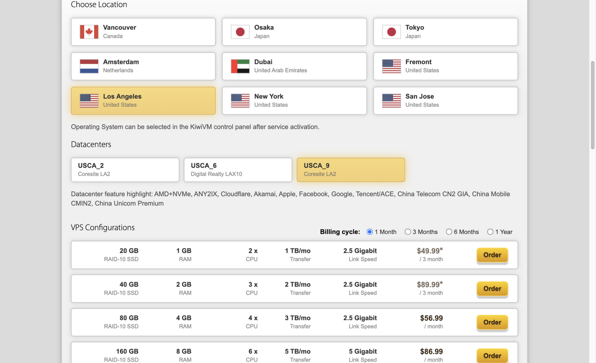

# 注册和下单的完整流程

第一次买，流程其实很简单：注册、选套餐、选机房、付款。十分钟左右能弄完。

## 一、注册账号

打开官网，点右上角的 Register。邮箱填常用的，密码别和别处一样。

会有个人机验证，按提示点几下。过不去就换个浏览器，或者开个梯子再试。

## 二、选套餐

登录后进 Order，看到的就是全部套餐。

新手看 20G 那几款就够。名字里带 CN2 GIA 的是线路更好的，价格也高，按自己的用途挑。

不确定选哪个，先买最便宜的 20G，用着不合适再升级。

## 三、选机房

页面上方选城市，下方选具体机房。

洛杉矶有不止一个机房，线路不完全一样。点进去能看到说明，挑一个符合用途的。

拿不准就选默认的，官网推荐的一般不会错。

## 四、付款

核对三件事：套餐对不对、周期是不是年付、总价多少。

付款方式选支付宝，扫码就行。付完等几分钟，机器就开好了，邮件里有 IP 和 root 密码。

## 五、装系统

登录 KiwiVM，点 Install new OS，选一个系统，比如 Debian 或者 Ubuntu，等一分钟。

装完用 SSH 连上去，就可以开始折腾了。

第一次连不上，先看[这篇排查](../profile/README.md)。

## 开始吧

👉 [打开官网开始注册](https://bandwagonhost.com/aff.php?aff=82279)。

---

个人整理，非官方。
